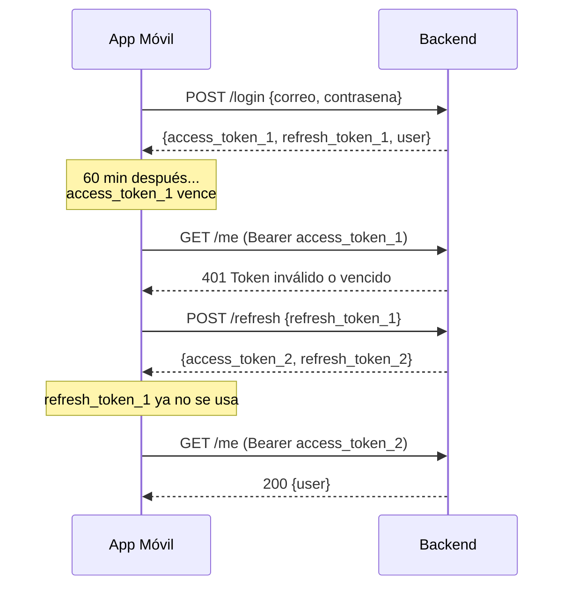

# Cambios Backend — Preparación para Producción Móvil

## ✅ 1. CORS para orígenes nativos

Se agregaron los dos orígenes de Capacitor a la configuración existente en [`main.py`](file:///c:/Users/SISTEMAS14/Documents/Proyecto EntregaProductos/app/config/main.py#L69-L80):

| Origen | Plataforma |
|---|---|
| `http://localhost:5173` | Vite dev server (ya existía) |
| `http://localhost` | **Android WebView** (nuevo) |
| `capacitor://localhost` | **iOS WebView** (nuevo) |

**Métodos:** `GET`, `POST`, `PUT`, `DELETE`, `OPTIONS`
**Headers:** `Authorization`, `Content-Type`
**Credentials:** habilitados

> [!NOTE]
> Se acotaron los métodos y headers al subconjunto que realmente usa la app, en vez del `*` anterior. Si algún endpoint futuro necesita otro método (ej. `PATCH`), habrá que agregarlo a la lista.

---

## ✅ 2. Refresh Token

### Archivos modificados

| Archivo | Cambio |
|---|---|
| [`jwt.py`](file:///c:/Users/SISTEMAS14/Documents/Proyecto EntregaProductos/app/core/jwt.py) | `create_refresh_token()` y `decode_refresh_token()` |
| [`schemas.py`](file:///c:/Users/SISTEMAS14/Documents/Proyecto EntregaProductos/app/modulos/auth/schemas.py) | `RefreshRequest`, `RefreshResponse`, campo `refresh_token` en `LoginResponse` |
| [`services.py`](file:///c:/Users/SISTEMAS14/Documents/Proyecto EntregaProductos/app/modulos/auth/services.py) | Lógica de `refresh()` con rotación |
| [`router.py`](file:///c:/Users/SISTEMAS14/Documents/Proyecto EntregaProductos/app/modulos/auth/router.py) | Endpoint `POST /refresh` |
| [`errors.py`](file:///c:/Users/SISTEMAS14/Documents/Proyecto EntregaProductos/app/modulos/auth/errors.py) | Mensaje y doc de error para refresh inválido |
| [`.env`](file:///c:/Users/SISTEMAS14/Documents/Proyecto EntregaProductos/.env) / [`.env.example`](file:///c:/Users/SISTEMAS14/Documents/Proyecto EntregaProductos/.env.example) | Variable `REFRESH_TOKEN_EXPIRE_DAYS=7` |

### Contrato

#### `POST /login` — respuesta actualizada

```json
{
  "access_token": "eyJ...",
  "refresh_token": "eyJ...",
  "token_type": "bearer",
  "user": {
    "id": 1,
    "nombre": "Administrador",
    "correo": "admin@entrega.com",
    "rol": "admin",
    "permisos": [{"id": 1, "nombre": "ver_facturas"}]
  }
}
```

- El body de entrada **no cambió**: sigue siendo `{ "correo": "...", "contrasena": "..." }`
- El `access_token` sigue venciendo a los **60 minutos**
- Se agregó `refresh_token` (JWT, vence a los **7 días** por defecto)

#### `POST /refresh` — endpoint nuevo

**Request:**
```json
{
  "refresh_token": "eyJ..."
}
```

**Response (200):**
```json
{
  "access_token": "eyJ...",
  "refresh_token": "eyJ...",
  "token_type": "bearer"
}
```

**Errores:**
- `401` → `{"detail": "Refresh token inválido o vencido"}` si el token está expirado, alterado, no es de tipo refresh, o el usuario fue desactivado
- `422` → validación estándar si falta el campo `refresh_token`

### Comportamiento de rotación



> [!IMPORTANT]
> **Rotación:** cada llamada a `/refresh` invalida conceptualmente el refresh_token anterior y devuelve uno nuevo. El frontend debe guardar siempre el último `refresh_token` recibido. No hay blacklist server-side (stateless), pero cada token tiene un `jti` único que permite agregar una en el futuro si se necesita.

### Configuración

| Variable | Default | Descripción |
|---|---|---|
| `REFRESH_TOKEN_EXPIRE_DAYS` | `7` | Días de validez del refresh token. Cambiar a `30` si prefieren un mes |

---

## 🚫 3. Lo que NO se cambió

- ✅ El body de `/login` sigue siendo `{"correo", "contrasena"}` (no username/password, no form-data)
- ✅ Roles, permisos, facturas y estadísticas sin cambios
- ✅ El CORS del front web (`http://localhost:5173`) sigue funcionando exactamente igual
- ✅ `Authorization: Bearer <access_token>` sin cambios en la forma de autenticarse

---

## 📱 Integración sugerida en el frontend móvil

```typescript
// Al recibir un 401:
// 1. Intentar POST /refresh con el refresh_token guardado
// 2. Si 200 → guardar nuevos tokens, reintentar petición original
// 3. Si 401 → cerrar sesión con "No ha iniciado sesión"
```
